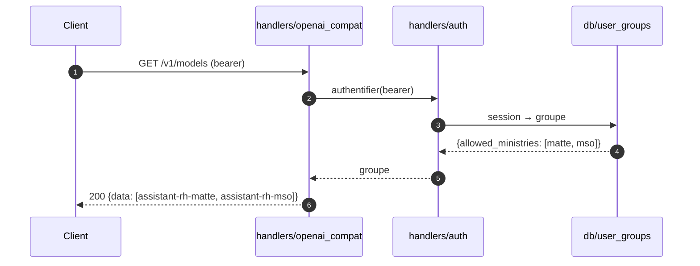
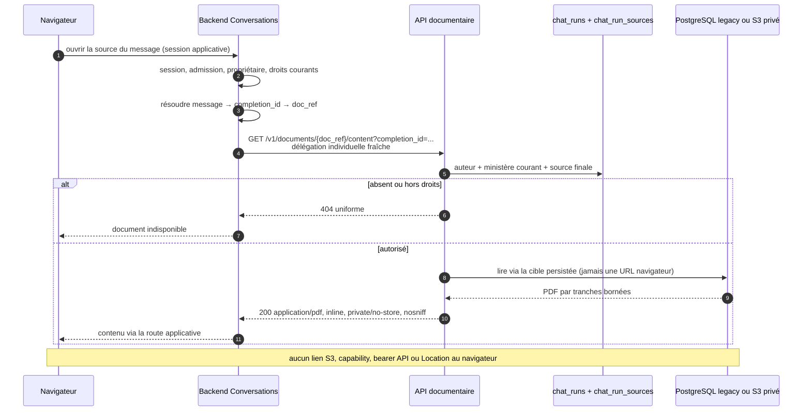
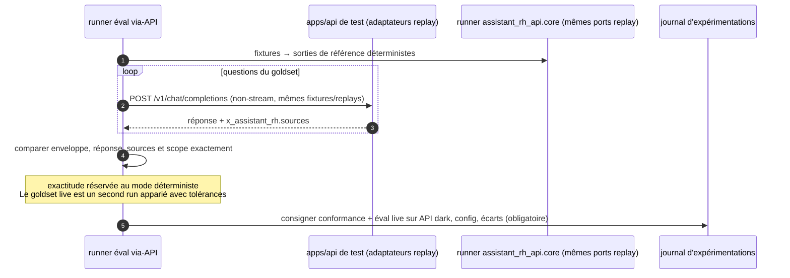
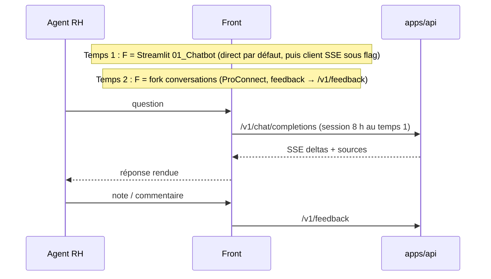

# Diagrammes de séquence

> Référence : [contrat API](02-api-contract.md) · [architecture cible](01-target-architecture.md).

## 1. `POST /v1/chat/completions` (stream)

Le chemin nominal complet, avec la résolution session → groupe → modèle → ministère.

```mermaid
sequenceDiagram
    autonumber
    participant C as Client (Streamlit ; provider conversations en test)
    participant H as handlers/openai_compat
    participant A as handlers/auth
    participant UG as db/user_groups
    participant CS as assistant_rh_api.core/ChatService
    participant W as worker borné + RunContext
    participant CFG as db/config_store
    participant P as assistant_rh_api.core/pipeline (steps)
    participant S as db/search
    participant GW as gateways (Albert, reranker)
    participant CR as db/chat_run_store (run + sources + traces)

    C->>H: POST /v1/chat/completions (bearer, model, messages, stream=true)
    H->>A: authentifier(bearer)
    A->>UG: résoudre session opaque non expirée → groupe
    UG-->>A: groupe {allowed_ministries, default_ministry}
    A-->>H: 401 si inconnu
    H->>H: model → ministère (403 si hors allowed, fallback default si "assistant-rh")
    H->>H: messages → (question, historique), system ignorés
    H->>H: borner historique (5 tours), retirer blocs sources
    H->>CS: créer requête(question, historique, ministère, conversation_id)
    CS->>CFG: config runtime (cache TTL ~15 s)
    CS->>CS: resolve_retrieval_scope(ministère) → table_keys
    CS->>W: démarrer RunContext isolé
    W->>P: process_query(question, historique)
    P->>GW: embeddings / reformulation (Albert)
    Note over P: gate hors-périmètre → réponse de refus (200, pas d'erreur)
    W->>P: run_stream(qr, historique, turn_id, scope)
    P->>S: recherches vector + lexicale (table_keys, top_k)
    S-->>P: chunks scorés bruts
    P->>P: fusion, dédup, anti-redondance (core)
    P->>GW: rerank(candidats) puis gate/seuils (core)
    P->>CFG: charger template du ministère via PromptStorePort
    P->>P: composer prompt ministère + contexte (core)
    P->>GW: chat_stream(prompt ministère, contexte, historique)
    loop tokens
        GW-->>P: token
        P-->>W: token
        W-->>H: token via file async
        H-->>C: SSE chunk delta
    end
    P-->>W: PipelineResult explicite (sources finales, timings)
    W->>CR: transaction : chat_run + chat_run_sources finales ordonnées + traces de toutes les étapes
    CR-->>W: commit ok
    W-->>H: résultat final durable
    H-->>C: chunk bloc sources + chunk final (finish_reason=stop, x_assistant_rh) + [DONE]
```

Pendant le retrieval, le handler SSE émet `: ping` indépendamment du worker. Sur déconnexion ou erreur après démarrage, il annule ce qui peut l'être, persiste `cancelled`/`failed` et ferme sans `[DONE]`. Variante non-stream : la réponse est assemblée en un seul `chat.completion` ; le log `chat_run` précède la réponse HTTP.

## 2. `POST /v1/auth/session`

```mermaid
sequenceDiagram
    autonumber
    participant ST as Backend Streamlit
    participant SRL as rate limiter Streamlit
    participant H as handlers/auth + rate limiter API
    participant UG as db/user_groups
    participant S as db/auth_sessions

    ST->>SRL: quota visiteur + slug (IP de l'ingress de confiance)
    SRL-->>ST: 429 + Retry-After si dépassé
    ST->>H: POST {slug, password}
    H->>H: quotas source directe + slug + global ; backoff temporaire
    H->>UG: lire hash + politique + credential_revision
    H->>H: vérification PBKDF2 constante, hash factice si absent
    H-->>ST: 401 générique si absent/invalide
    H->>S: créer session opaque hashée, expiration +8 h
    S-->>H: session créée
    H-->>ST: bearer affiché une fois + groupe + expires_at
    Note over ST: bearer conservé dans la session serveur uniquement<br/>perte d'état, expiration ou reset → réauthentification
    ST->>H: DELETE /v1/auth/session au logout
    H-->>ST: 204 puis effacement de l'état local
```

## 3. `GET /v1/models`



## 4. `POST /v1/feedback`

```mermaid
sequenceDiagram
    autonumber
    participant C as Client
    participant H as handlers/feedback
    participant A as handlers/auth
    participant S as core/FeedbackService
    participant FS as db/feedback_store

    C->>H: POST /v1/feedback {completion_id, stars, raisons, commentaire}
    H->>A: authentifier(session de groupe)
    H->>H: completion_id → turn_id (strip "chatcmpl-")
    H->>S: feedback validé + groupe + turn_id
    S->>S: dériver helpful ; normaliser ; calculer l'empreinte
    S->>FS: transaction ; verrouiller le chat_run parent ; convertir stars 1–5 → stockage 0–4
    alt empreinte identique au feedback courant
        FS-->>S: no-op, aucun nouvel audit
    else charge différente
        FS->>FS: archiver précédent avec groupe + hash de session
        FS->>FS: remplacer courant ; préserver annotations humaines ; réinitialiser analyse IA
        FS-->>S: mis à jour
    end
    S-->>H: ok | run inconnu/hors groupe
    H-->>C: 204 | 404
```

## 5. Admin Streamlit — exception DB directe

```mermaid
sequenceDiagram
    autonumber
    participant ST as Streamlit admin
    participant AUTH as src/ui/admin_auth
    participant DB as PostgreSQL
    participant ENV as environnement serveur

    ST->>AUTH: require_admin()
    alt groupe issu du cookie chiffré
        AUTH->>DB: revérifier is_admin du groupe
        DB-->>AUTH: rôle is_admin
    else fallback mot de passe
        AUTH->>ENV: comparer ADMIN_PASSWORD côté serveur
        ENV-->>AUTH: valide | invalide
    end
    AUTH-->>ST: stop si non-admin
    ST->>DB: lecture/mutation allowlistée
    DB-->>ST: résultat
    Note over ST,DB: aucun endpoint /admin/* requis pour M4<br/>nouveau DDL par migrations ; DDL historique en dette de durcissement
```

Chat Logs, Feedback Dashboard, Admin Config, DB/Goldset Explorer, les pages d'évaluation, Pipeline Timeline et User Groups conservent ce chemin après M4. Leur migration vers une API, Grafana/Tempo, LangSmith ou RAG-ops est un chantier séparé.

## 6. Document interne — contenu via le backend Conversations



Chaque nouvelle requête refait les contrôles, y compris si le lecteur envoie `Range` (ignoré : réponse complète `200`, `Accept-Ranges: none`). Chaque tentative serveur utilise une nouvelle assertion. Le retrait de droits bloque la requête suivante ; un transfert autorisé peut se terminer. Déconnexion/annulation ferme l'amont. Les bornes, erreurs et responsabilités de #594 sont décrites dans le [contrat D2](02-api-contract.md#accès-documentaire).

## 7. Éval via-API (test de fidélité de l'adaptateur, D3)



## 8. Temps 1 → Temps 2 (vue macro)



Pendant le canary du temps 1, un rollback de configuration renvoie Streamlit vers le pipeline direct sans rebuild. Cette branche disparaît uniquement après la fenêtre de stabilité de la phase F.
